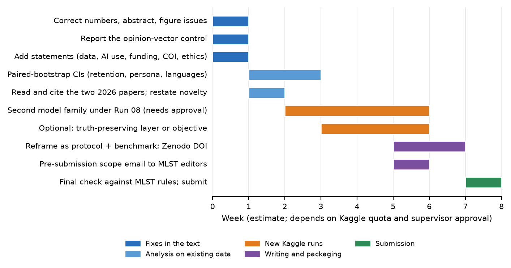
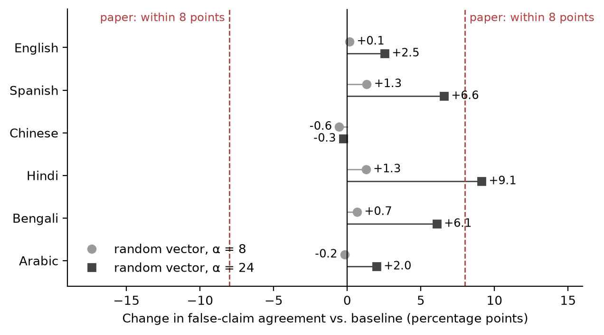
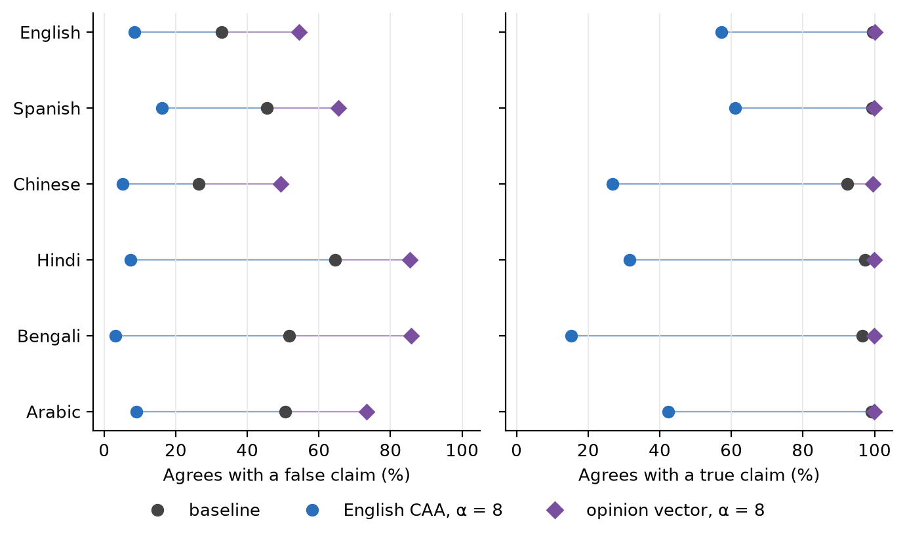
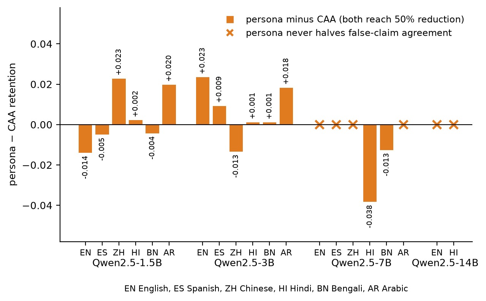
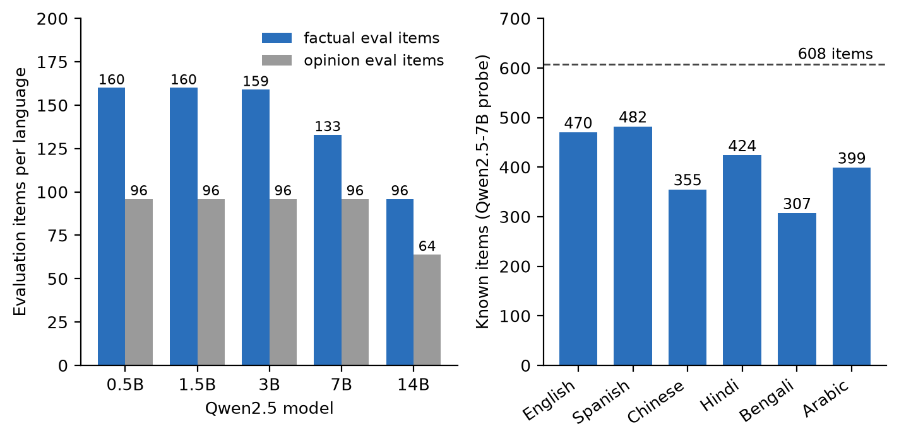

# Recommendation

**Target *Machine Learning: Science and Technology* (MLST), not *Engineering Research Express* (ERX).**

ERX's own scope page rules the paper out in its current form. AI and machine-learning submissions "must demonstrate a clear and substantive contribution to engineering", and manuscripts that "lack a strong engineering discipline focus are considered outside the scope of the journal and will not be considered for publication." A study of how language models respond to steering is not an engineering contribution, so it would most likely be rejected before review.

MLST is the closest IOP fit. It takes papers that "make conceptual, methodological or theoretical advances in machine learning" motivated by scientific problems, and it lists "explainability, causality and robustness" and "benchmark studies" among its method areas. NLP and AI safety are not named, so the paper has to be framed as an evaluation-methodology and robustness study, and the editors should be asked about scope first.

**Verdict for MLST:** not eligible as it stands. Probably eligible after the revisions below. I can't predict acceptance; reviewers and editors decide that.

A warning that applies across IOP: articles rejected in the same or a substantially similar form are generally not reconsidered by any IOP primary journal. Submit once, when the paper is ready.

# Journal comparison

| | *Engineering Research Express* | *Machine Learning: Engineering* | *Machine Learning: Science and Technology* |
|---|---|---|---|
| Scope fit | **Poor.** AI/ML papers need "a strong engineering discipline focus". | Weak. ML applied "across all areas of engineering". | **Partial, best of the three.** ML advances motivated by scientific problems; lists explainability, robustness, benchmarks. |
| Acceptance bar | Soundness only; "no subjective assessment" of novelty | Research papers need "a significant advance in the field" | Rigorous peer review; novelty matters |
| Length | Unlimited | Unlimited | Research papers normally up to 8,500 words |
| Review model | Single or double anonymous (author choice) | Same | Same |
| Open access | Hybrid; gold OA optional (USD 2,645) | Fully OA (USD 3,125) | Fully OA (USD 3,350; 25% off for IOP members; 40% off for authors from India and Indonesia) |
| Data policy | IOP standard (encouraged) | Data sharing and availability statement required | Data sharing and availability statement required |
| Indexing named on page | Scopus, Web of Science ESCI, EI Compendex | Scopus; Web of Science not listed | Scopus, Web of Science, EI Compendex |

Fees exclude VAT. Transformative agreements may cover them; check the IOPP Journal Finder for your institution.

# What has to change

The changes fall into three groups: fixes that any journal would require, a reframing that makes the paper fit MLST, and new work that lifts it over MLST's bar.

## A. Fixes any journal would require

**A1. Correct the numbers that don't match the result files** (small effort).

| Draft says | Files show | Change to |
|---|---|---|
| Random vector "within 8 points of baseline" (III-A) | Hindi at alpha 24: +9.1 pp | Report the real range and that the random vector raises false-claim agreement in 5 of 6 languages at alpha 24 |
| Persona cuts false-claim agreement "by only 23 to 30%" (III-B) | 22.1 to 29.7% | "22 to 30%" |
| Honesty gap shrinks "0.45 in Chinese" (III-A) | 0.44 | 0.44 |
| "The model says yes on 52% of our Bengali items" (I) | 52% is a mean probability | "gives yes a mean probability of 0.52" |
| "The cause is not a poor fit to other languages" (abstract) | No causal test | "The vector is not a poor fit to other languages: …" |
| "Persona vectors keep no more than CAA in any of the 14 cells" (claim 2) | Persona higher in 8 of 14, no CIs | "about the same as CAA" |
| Persona fails "at 7B" only (III-B) | Also fails at 14B in English and Hindi | Report 6 failures in 16 cells at 7B and 14B |

**A2. Report the opinion-vector control** (small to medium). Sec. II-D promises it and Results never show it. It *raises* false-claim agreement (Bengali 0.52 to 0.86) and pushes true-claim agreement to about 1.00. Check the sign at the opinion layer, then report it. It is the most direct evidence about what the factual vector controls, and reviewers will ask why a listed control is missing.

**A3. Add the statements MLST requires or expects** (small).

- **Data availability statement** (required at MLST). Deposit the item pools, scoring code and Run 08 outputs on Zenodo with a DOI.
- **AI disclosure statement** (IOP policy: required when AI materially helped prepare the manuscript). Name the tool, what it did, and how the authors checked it. Authors must personally verify every reference.
- **Funding, conflict of interest and ethics statements.** No human subjects, so the ethics statement is one sentence.

**A4. Tidy the layout** (small). Remove the empty "Appendix" heading at the end of page 7 and the mostly blank page 9. Fix the Fig. 5B legend, the Fig. 7 legend (persona listed but not plotted), and the Fig. 1 notation, which doesn't match Sec. II-C.

## B. Reframe the paper for MLST

MLST does not publish "we audited a model" papers by default. It publishes ML methodology and benchmarks. Truth collapse should be the evidence, and the protocol should be the contribution.

**B1. New framing.** Present the paper as an *evaluation protocol for activation steering across languages*, with Qwen2.5 (and a second family; see C1) as the test case. The protocol has four parts the field lacks:

1. Score agreement with false and true claims separately.
2. Compare methods at matched effect, not at a fixed alpha.
3. Floor-check any metric before drawing conclusions from it.
4. Test transfer with validity checks on the native vector.

**B2. Title options.** Neither overclaims beyond the evidence.

- With a second family: *Matched-Effect Evaluation of Steering Vectors Across Languages: English Anti-Sycophancy Vectors Suppress True-Claim Agreement*
- Qwen only: *Auditing Activation Steering Across Six Languages: An English Anti-Sycophancy Vector Suppresses True-Claim Agreement in Qwen2.5*

**B3. Restructure the contribution list.**

| Current claim | Revised contribution |
|---|---|
| 1. True-claim agreement falls everywhere | 1. A matched-effect, floor-checked protocol and released benchmark for cross-lingual steering evaluation |
| 2. Tuning does not fix it | 2. Truth collapse in all six languages, with paired CIs, in two model families |
| 3. The vector transfers, side effect included | 3. Transfer of the direction and its side effect (cosine, slope ratio, residual decomposition) |
| 4. Opinion metric usable in 20 of 30 cells | 4. Negative results stated as such: persona at matched effect, the opinion floor, 0.5B |

**B4. Use MLST's article features.** MLST has Benchmark and Dataset article types and encourages open code. Even as a Research paper, describe the released benchmark (items, templates in six languages, scoring code, outputs) in its own short section.

**B5. Write in MLST's register.** Readers come from physics, chemistry and other sciences, not NLP. Define sycophancy, activation steering and CAA in one plain paragraph each. Keep jargon such as "residual stream" to what the method needs.

**B6. Pre-submission email to the editors.** Send the abstract and three sentences on why it fits "explainability, causality and robustness" and "benchmark studies". Ask whether a language-model steering study is in scope. A "no" here costs nothing; a scope rejection after submission does.

## C. New work that lifts the paper over MLST's bar

**C1. A second model family under the Run 08 protocol** (large: code changes plus about 8 h of Kaggle per 7B-class model; needs supervisor approval). Llama, Gemma or Mistral. This is the change most likely to decide the outcome. Without it, scope every general claim to Qwen2.5.

**C2. Uncertainty on the key comparisons** (medium). Paired bootstraps over items for: matched-effect retention, persona minus CAA, and cross-language differences. The items are shared across languages, so pair them. This may need per-item outputs for the matched-effect stage.

**C3. Engage with recent work** (medium). Read arXiv:2606.11205, which appears to report over-disagreement from sycophancy steering in English (Llama-3-8B), and arXiv:2605.21006 (ICML 2026), which appears to report persona vectors that keep accuracy when the user is correct. Say what this paper adds (other languages, matched effect, floor check) and why the persona results differ. Also cite representation engineering (Zou et al. 2023), inference-time intervention (Li et al. 2023), Wei et al. 2023, and the refusal direction (Arditi et al. 2024).

**C4. Optional method result** (medium to large). Try a layer chosen to keep the honesty gap, or a steering objective that penalises loss of true-claim agreement. If either reduces truth collapse, the paper becomes a method paper, which is MLST's core. If neither helps, report that as a null result.

**C5. Address sample size openly** (small). Keep stating the pool limits: 96 to 160 factual items per model, set by the six-language intersection, with Bengali the tightest (307 of 608 items known at 7B). A larger pool is a future-work item, not a blocker.

# MLST submission checklist

| Item | Status now | Action |
|---|---|---|
| Scope fit | Partial | Reframe (B1 to B5); email editors (B6) |
| Length: research paper normally 8,500 words or fewer | About 4,700 words plus appendix | Room for C1 to C3 |
| Single PDF at first submission | IEEE draft compiles | IEEEtran is fine for round one; IOP typesets after acceptance |
| Anonymity | "Anonymous Authors" | Choose single or double anonymous at submission. If double, keep the public repo from naming the paper. |
| Data availability statement | Missing | A3 |
| AI disclosure | Missing | A3 |
| Funding, COI, ethics | Missing | A3 |
| Reproducibility: code, seeds, commit | Partial | Cite the Run 08 commit; add persona prompts, templates, wrong-option rule and seeds in an appendix |
| Numbers match evidence | 7 mismatches | A1 |
| Promised controls reported | One missing | A2 |
| ORCID for submitting author | Unknown | Required by IOP |

# If ERX is a hard requirement

Rewording alone won't get the paper past ERX's AI/ML scope rule. It would need real engineering content, which means a different paper:

- **A defined application with requirements:** for example, a multilingual tutoring assistant for Bengali and Hindi students, with acceptance criteria for answer reliability.
- **System-level results:** latency, memory and cost of steering on T4 hardware, and a deployment recipe.
- **A reliability-engineering test:** a pre-deployment check that detects truth collapse, with pass and fail thresholds, validated on the six languages.

That is several weeks of new experiments and writing. I would only do it if the venue can't change. Done thinly, it reads as a relabelled NLP paper and still gets rejected on scope.

# Other venues that fit without reframing

If MLST's editors say the topic is out of scope, the revised paper (with A and C done) also suits ACL Rolling Review (ACL or EMNLP), TMLR, or a NeurIPS or ICLR workshop on safety or interpretability. These are the venues already named in the project notes.

# Sources

- About Engineering Research Express — https://publishingsupport.iopscience.iop.org/journals/engineering-research-express/about-engineering-research-express
- About Machine Learning: Engineering — https://publishingsupport.iopscience.iop.org/journals/machine-learning-engineering/about-machine-learning-engineering/
- About Machine Learning: Science and Technology — https://publishingsupport.iopscience.iop.org/?p=3555
- IOP author, reviewer, data and ethics pages, as saved in the *Q2 Publisher* folder (collected 24 Nov 2026)
- arXiv:2606.11205 — https://arxiv.org/abs/2606.11205 ; arXiv:2605.21006 — https://arxiv.org/abs/2605.21006 (seen only as search summaries; read in full before citing)
- Run 08 result files in results/08_unified_scale_run/
