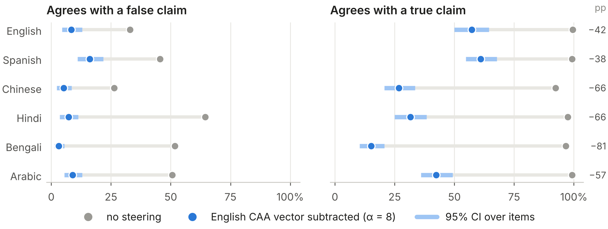
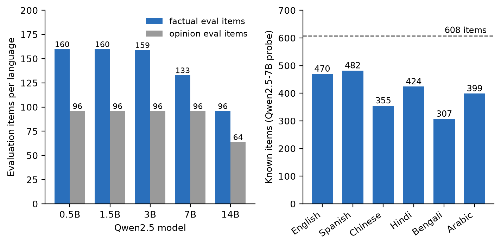
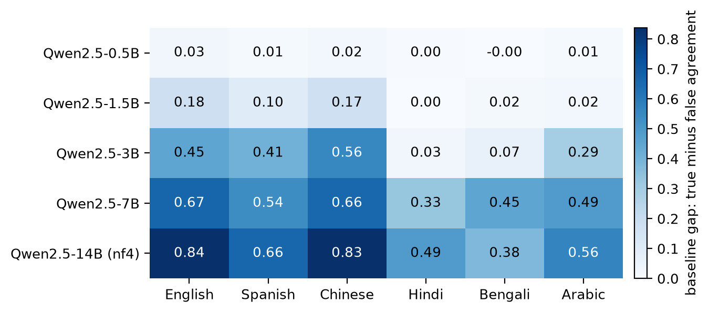
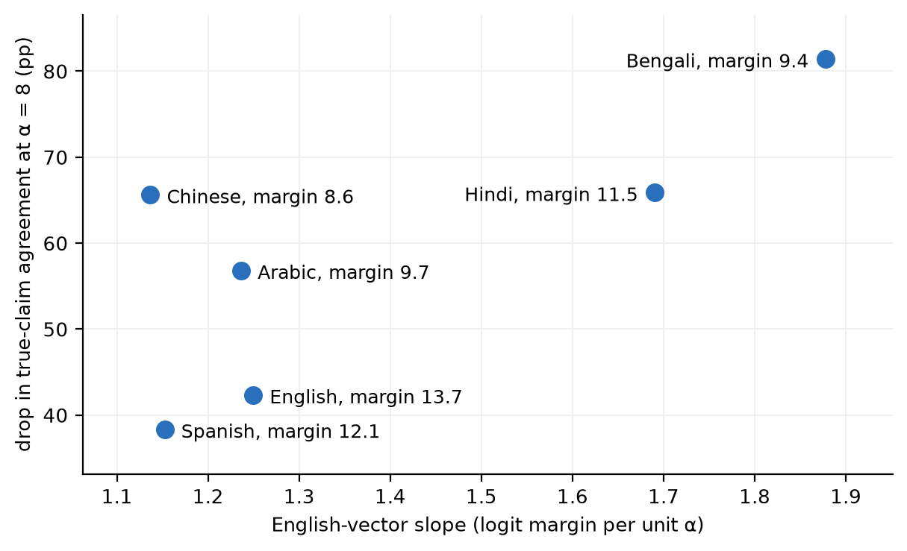
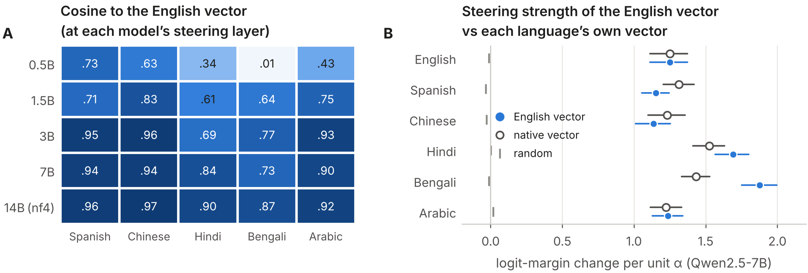
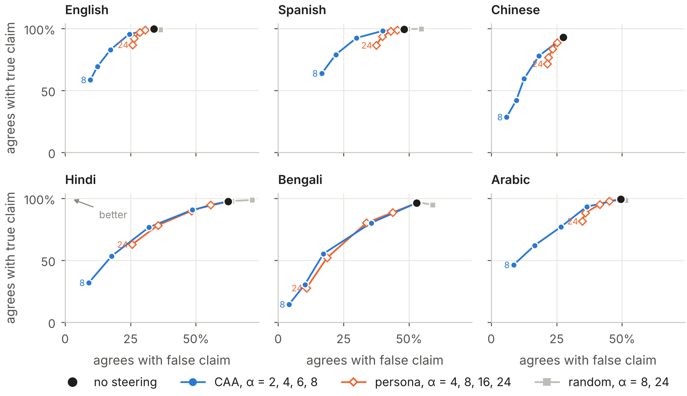
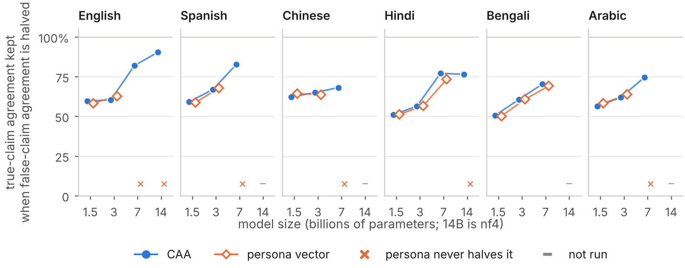
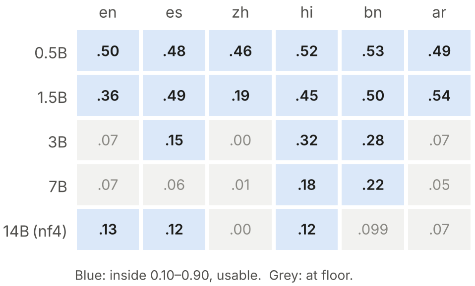
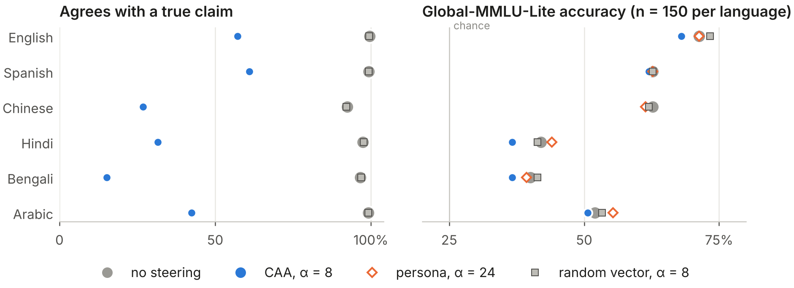

# Summary

The paper builds a contrastive activation addition (CAA) anti-sycophancy vector from English two-option prompts. It subtracts that vector from Qwen2.5 models (0.5B to 14B) while they answer the same items in English, Spanish, Chinese, Hindi, Bengali and Arabic. It makes four claims:

1. Agreement with false claims falls, and agreement with true claims falls a lot too, most of all in Bengali.
2. At matched effect, models keep 51 to 90% of true-claim agreement when false-claim agreement is halved, and persona vectors do no better.
3. Vectors built in each language point close to the English one, and the English vector steers other languages about as hard as their own vectors do.
4. A floor check leaves only 20 of 30 opinion cells usable.

**Recommendation: major revision.** Do not submit as it stands. The experiments are careful for a free-tier compute budget, the matched-effect design and floor check are real contributions, and the headline numbers reproduce from the Run 08 files. The blocking problems are:

- All results come from one model family.
- The English half of the main finding may already be published.
- The persona null may conflict with recent work.
- One promised control is missing, and its result is notable.
- The persona and size comparisons have no uncertainty.
- A new causal sentence in the abstract goes beyond the data.
- The statements IOP expects are absent.

IOP says that articles rejected in the same or a substantially similar form are generally not reconsidered by *any* IOP primary journal. An early rejection could close off the whole publisher, so finish the blocking items first.

# Strengths

- **The right measurement.** Agreement with false and true claims is tracked separately, so a fix that suppresses all agreement cannot pass as an honesty fix.
- **Matched-effect comparison.** Methods are compared at the dose where each halves false-claim agreement, not at a fixed alpha.
- **Sound bookkeeping.** Both option orders are scored to cancel letter bias. Folds are over items and shared across languages, so the English vector never sees a held-out item in any language (confirmed in `notebooks/src/08_unified_scale_run.py`, `FAC_FOLD`).
- **Controls.** A random vector, a capability benchmark, and a validity check before any transfer ratio.
- **Honest scoping in the body.** The "contrarian knob" is labelled as interpretation ("the data show the behaviour and not the mechanism"). Opinion transfer ratios are withheld. The persona null is in the main text.
- **Clear prose** with a concrete opening example and a four-claim list tied to sections.

# Weaknesses

1. **One model family.** Every steering result is on Qwen2.5. The title ("An English Anti-Sycophancy Vector Makes Models Disagree…") and the conclusion still read as general claims.
2. **A causal claim in the abstract.** The abstract now says "The cause is not a poor fit to other languages." The body says only that the vectors align and transfer, and Sec. III-A says the data "show the behaviour and not the mechanism". High cosine and transfer ratios rule out one explanation at best. They do not establish the cause. Reword, e.g. "The vector is not a poor fit to other languages: …".
3. **Novelty may be overstated.** A 2026 preprint (arXiv:2606.11205) appears to report the same English-language over-disagreement in Llama-3-8B. *Playing Devil's Advocate* (ICML 2026, arXiv:2605.21006) appears to find that scrutiny-oriented persona vectors keep accuracy when the user is correct, which conflicts with this paper's persona null. I saw only search summaries of both papers; the authors must read them in full.
4. **A promised control is not reported.** Sec. II-D lists "the opinion vector on the factual task" as a control. Its result is substantial and absent (Figure 4).
5. **No uncertainty on key comparisons.** Matched-effect retention and persona minus CAA are interpolated with no CIs. Claim 2's "no more than CAA in any of the 14 cells" does not hold as written (Figure 5).
6. **Several numbers in the text don't match the files** (Table 2 of this report).
7. **The vector is not standard CAA.** It is mean(wrong-claim difference) minus mean(true-claim difference) on probe-filtered items. Results should be stated for this construction.
8. **True-claim agreement starts at a ceiling** (0.92 to 1.00 at 7B) because of the knowledge filter, so that metric can only fall. The honesty gap and matched effect handle this better.
9. **Missing statements and layout problems.** There are no AI disclosure, data availability, funding, conflict of interest or ethics statements. Page 7 ends with an empty "Appendix" heading; Tables II and III and Fig. 7 float to pages 8 and 9, leaving page 9 mostly blank.

# Fit with the publisher

The *Q2 Publisher* folder covers IOP Publishing as a whole. **No target journal has been chosen**, and none of the per-journal scope, review-model, length or data-policy pages were fetched. I could not check scope, page limit, template or anonymity against a specific journal and have not guessed. Candidates on the list are *Machine Learning: Science and Technology*, *AI for Science* and *AI Horizons*.

| Requirement | Source in folder | Status of the draft |
|---|---|---|
| Scope | Per-journal pages (not fetched) | Unknown. IOP usually rejects papers that are "technically sound, but of limited interest". |
| Format | A single PDF is enough at first submission | The compiled IEEEtran PDF (9 pages) is fine for round one. Fix the appendix layout. |
| Page limit | Not in folder | Unknown |
| Anonymity | Varies by journal | "Anonymous Authors" suits double-anonymous review. The public repo shares the topic. Preprints are allowed. |
| Ethics statement | Submission checklist | No human subjects; a short statement is still missing. |
| GenAI disclosure | IOP ethics policy | Required when AI materially helped prepare the manuscript. Missing. Authors must personally verify every reference. |
| Data availability | IOP standard data policy | Encouraged, not required. Missing. Archive results with a DOI (e.g. Zenodo). |
| Funding, COI | Preflight checks | Missing |
| Reproducibility | Reviewer "scientific rigour" score | Partly met (see Methods) |

# Claims versus evidence

Table 1 lists the claims that check out. Table 2 lists the ones that need correction.

**Table 1. Claims supported by the Run 08 files.**

| Claim (section) | Evidence | Note |
|---|---|---|
| 7B: false-claim agreement falls to 3 to 16%, true-claim agreement drops 38 to 81 pp, smallest CI lower bound 32 pp (III-A) | 7B `caa_collapse.csv`, `paper/tables/truth_collapse_ci.csv` | Exact match |
| 3B drop 53 to 85 pp, 14B drop 32 to 79 pp (III-A) | `truth_collapse_ci.csv`, Table II | 14B is NF4 with 96 items |
| First dose step costs zh 15 and bn 16 points of true-claim agreement (III-A) | 7B `dose_response.csv` | 100 items, no CIs |
| MMLU change under CAA at 7B is -5.3 to -0.7; random -0.7 to +2.0 (III-A) | 7B `capability_mmlu.csv` | 150 questions per language |
| CAA retention 1.5B 0.51-0.62, 3B 0.56-0.67, 7B 0.68-0.83, 14B en 0.90 / hi 0.77 (III-B) | `matched_effect.csv` per model | Interpolated, no CIs; 14B has 2 languages, 64 items |
| Cosine to English 0.73 (bn) to 0.94 at 7B (III-C) | `cosine_factual.csv`, layer 16 | |
| Transfer ratio 0.88 to 1.31 at 7B; random slope within 0.04 of zero (III-C) | 7B `transfer_factual.csv`, Table III | |
| 20 of 30 opinion cells pass the 0.10 to 0.90 floor check (III-D) | `baseline.csv`, `opinion_floor_pass.csv` | The three 14B passes sit within one or two items of 0.10 |
| Opinion effects: CAA within 0.03 from 3B up; persona raises sycophancy in 7 of 8 cells (III-D) | `opinion_floor_pass.csv` | |
| 7B NF4 also collapses, 31 to 84 pp (V, Limitations) | 7B nf4 `caa_collapse.csv` | Correctly kept out of any quantisation claim |

**Table 2. Claims that need correction.**

| Claim in draft | What the files show | Fix |
|---|---|---|
| "The cause is not a poor fit to other languages" (abstract) | Cosine and transfer data rule out one explanation; they do not identify a cause | Remove "cause" |
| Random vector at alpha 8 and 24 "leaves both within 8 points of baseline" (III-A) | Hindi, random alpha = 24: false-claim agreement 0.624 to 0.715, **+9.1 pp**. It rises in 5 of 6 languages (Figure 2). | Report the actual range and the upward drift |
| Persona at alpha = 24 lowers false-claim agreement "by only 23 to 30%" at 7B (III-B) | es 22.1%, zh 22.4%, en 24.0%, ar 29.7% | "22 to 30%" |
| Honesty gap shrinks by "0.45 in Chinese" (III-A) | -0.4446; the draft's own Table II prints -0.44 | 0.44 |
| "Persona vectors keep no more than CAA in any of the 14 cells" (claim 2) | Persona minus CAA is positive in 8 of 14 cells, up to +0.024, with no CIs (Figure 5) | "about the same" |
| "The model says yes on 52% of our Bengali items" (I, Fig. 1) | 52% is a mean of sigma(margin), not a share of items | Reword, or report argmax rates |
| "Models keep only 51 to 90%" (abstract) | Pools fp16 sizes with two 14B NF4 cells | Split by size, or give 7B alone |
| "At 14B the largest change is -11 points (Bengali)" (III-A) | True for CAA. Persona costs **-13** in Bengali at 14B; CAA costs -10.7 in Spanish at 3B. | Say "CAA" and report the others |
| Table I gives the every-2nd-layer sweep to 7B; Limitations give the coarser sweep to 14B | Both 7B and 14B sweep every second layer | Make consistent |
| Table I: 0.5B matched-effect languages "all 6" | `matched_effect.csv`: CAA never halves false-claim agreement at 0.5B in any language | State that as a result |
| Persona reaches the target "at 7B only in Hindi and Bengali" (III-B) | Silent on 14B, where persona also fails in English and Hindi (draft Fig. 4) | Report 6 failures in 16 tested cells at 7B and 14B |

**Comparisons across runs.** The draft reports no numbers from Runs 04, 07a or 07b, which complies with the rule. Earlier work appears only as motivation: the opinion pilot that hit the floor, and the knowledge probe used to choose Qwen. The draft no longer says why alpha = 8 was chosen, and Run 08 gives no reason for it.

**Small samples.** Factual evaluation uses 96 to 160 items. The 7B pool (166 items) is set by the six-language intersection. Bengali is the tightest constraint (307 of 608 items known at 7B), followed by Chinese (355). Matched effect uses 100 items (64 at 14B). Opinion cells use 96 (64 at 14B).

# Methods and statistics

**1. The opinion-vector control is missing, and its result matters.** On Qwen2.5-7B, the opinion vector, applied with the sign that *reduces* opinion sycophancy, *raises* false-claim agreement sharply (en 0.33 to 0.55, bn 0.52 to 0.86) and pushes true-claim agreement to about 1.00 (7B `controls.csv`). Two "anti-sycophancy" directions move factual agreement in opposite directions. That bears directly on the "contrarian knob" reading. The sign was chosen at the opinion layer and applied at the factual layer, so it needs checking. Either way, the result must be reported.

**2. Persona versus CAA needs uncertainty.** The 14 cells where both methods reach the target differ by -0.04 to +0.024, without CIs. That supports "about the same", not "never better". The persona vector is also unstable (split-half cosine 0.33 to 0.48). It is a last-token system-prompt contrast on 70 English prompts, which may differ from Chen et al.'s extraction. If so, the null applies to this variant only.

**3. Apply exclusion rules consistently.** The draft drops 0.5B because its honesty gap (AT minus AW) is near zero. But 1.5B Hindi has a gap of 0.00 (AT 0.99, AW 0.99, flagged at ceiling), and several other cells are near 0.02 to 0.07. Those stay in.

**4. Layer selection.** The layer is chosen by the largest *English* steering effect, sweeping every second layer at 7B and 14B. A layer chosen to keep the honesty gap might not collapse. Without that check, collapse may come partly from the selection rule.

**5. Paired statistics.** Items are the same across languages, so cross-language contrasts ("Bengali's interval does not overlap Spanish's") should use a paired bootstrap on the difference, not overlap of marginal CIs.

**6. What drives the Bengali result.** Bengali's baseline true-claim margin (9.4) is not the smallest; Chinese's is (8.6). The English vector's slope in Bengali is 1.88, against 1.25 in English. The larger Bengali drop therefore comes mostly from a stronger steer, not lower confidence. `residual_decomposition.csv` adds that the native Bengali vector's steering lies almost entirely along the English direction (residual slope 0.07 against 1.84). Both points would sharpen Sec. III-C, which currently says only that the pattern may be coincidence.

**7. Further method points.**

- There is no plain agree-minus-disagree ("say yes") baseline vector. Its cosine with the CAA vector would test the contrarian-knob reading directly.
- The size trend is confounded: each model's item set is the intersection of items *that model* knows.
- Reproducibility gaps: the persona prompts, the template text in each language, the wrong-option rule, the seeds, and the code commit that produced Run 08 are not given. The working-tree source differs from HEAD by about 236 lines.

# Null and negative results

- **The persona null** is in the main text and stated plainly ("we count this as a null result"), which is good. It is under-reported in one respect: persona also fails to halve false-claim agreement at 14B in English and Hindi (visible in Fig. 4, not in the text). Across 7B and 14B it fails in 6 of 16 tested cells.
- **0.5B** is correctly called uninformative, but the text should also state that CAA never reaches the 50% target there.
- **Opinion transfer ratios** are correctly withheld.
- **The opinion-vector control** is the one surprising result left out.

# Presentation

- The prose is clear and well hedged in the body. The four-claim list is a good addition.
- **Abstract:** remove the causal sentence (Weakness 2).
- **Fig. 1** writes h <- h - alpha v, while Sec. II-C writes h + alpha s v-hat with negative alpha. Make them match and include the scale s.
- **Fig. 3** uses the first 100 items, so its baselines differ from Fig. 2 (Hindi false-claim agreement 62% against 64%). Say so in the caption.
- **Fig. 4** should say why 0.5B is absent.
- **Fig. 5B:** the legend overlaps the data.
- **Fig. 7:** the legend lists persona, but the left panel plots no persona marker.
- **Sec. III-D** lists only some of the 10 failing opinion cells ("These include…"). List all of them or point to Fig. 6.
- **Layout:** the empty "Appendix" heading at the end of page 7 and the mostly blank page 9. Place Tables II and III and Fig. 7 under the heading, or move Fig. 7 into the main text.

# Required changes

**Blocking**

| # | Change | Effort |
|---|---|---|
| B1 | Add at least one more model family under the Run 08 protocol, or scope the title and every general claim to Qwen2.5. A journal reviewer will very likely ask for the second family either way. | Large |
| B2 | Read and engage with arXiv:2606.11205 and arXiv:2605.21006. Restate novelty and explain the persona disagreement. | Medium |
| B3 | Report the opinion-vector control, check its sign across layers, and discuss it. | Small to medium |
| B4 | Paired-bootstrap CIs for retention, persona minus CAA, and cross-language contrasts. Soften "no more than CAA in any" to "about the same". | Medium |
| B5 | Fix the errors in Table 2 of this report, including the causal sentence in the abstract. | Small |
| B6 | Report the persona failures at 14B. | Small |
| B7 | Choose the journal. Fetch its scope, review model, length and data-policy pages. | Small |
| B8 | Add AI disclosure, data availability (with DOI), funding, COI and ethics statements. Fix the appendix layout. | Small |

**Suggested**

| # | Change | Effort |
|---|---|---|
| S1 | Plain "say yes" vector and its cosine to CAA; report the residual decomposition. | Medium |
| S2 | Layer selection that maximises the honesty gap. | Medium |
| S3 | Apply the 0.5B exclusion rule consistently. | Small |
| S4 | Report persona MMLU cost at 14B (-13 bn) and CAA at 3B (-10.7 es). | Small |
| S5 | Justify alpha = 8 within Run 08, or lead with matched effect. | Small |
| S6 | Cite RepE (Zou et al. 2023), ITI (Li et al. 2023), Wei et al. 2023, Arditi et al. 2024. | Small |
| S7 | Appendix with persona prompts, templates, wrong-option rule, seeds, commit. | Small |
| S8 | Larger, natively checked item pools; free-text evaluation. | Large |
| S9 | Figure fixes listed under Presentation. | Small |

# Questions for the authors

1. Was the opinion vector's sign chosen at the opinion layer and applied at the factual layer? Does its effect keep the same sign at the opinion layer?
2. Does collapse persist if the layer is chosen to keep the honesty gap?
3. How does your persona extraction differ from Chen et al.'s, and could that explain the conflict with arXiv:2605.21006?
4. What happens on items the model does not reliably know?
5. Why alpha = 8? Do cross-language differences hold at the matched-effect dose (alpha of about 3 to 5.5 at 7B) under paired tests?
6. Which commit of `08_unified_scale_run.py` produced each results folder?

# Sources

- arXiv:2606.11205 — https://arxiv.org/abs/2606.11205
- Playing Devil's Advocate, ICML 2026 — https://icml.cc/virtual/2026/69333 ; arXiv:2605.21006 — https://arxiv.org/abs/2605.21006
- IOP Publishing author and reviewer pages, as saved in the *Q2 Publisher* folder (collected 24 Nov 2026).
- Run 08 result files in `results/08_unified_scale_run/` (folders as listed in the project notes).
